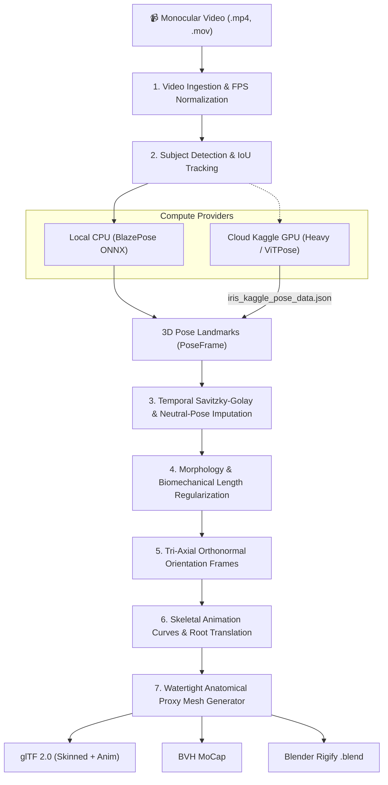

# 🌌 Leocherd Iris Energy
### Python-First Universal AI Video-to-3D Rigging & Motion Reconstruction Platform

[](https://www.python.org/downloads/)
[](LICENSE)
[](https://www.khronos.org/gltf/)
[](https://www.blender.org/)
[](experiments/kaggle/)

**Leocherd Iris Energy** is an extensible, Python-first 3D computer vision and rigging engine that reconstructs articulated skeletal structures, biomechanically regularized forward kinematics, and production-ready 3D animation assets directly from standard monocular video footage (`.mp4`, `.mov`).

---

## 🌟 Key Highlights

- **🎥 Monocular Video to 3D Articulation**: Direct frame extraction, subject detection, 3D landmark estimation, and temporal trajectory imputation.
- **🦾 Anatomical Stylized Mannequin**: Procedural, watertight humanoid proxy mesh with sculpted ribcage, deltoids, tapered limbs, face visor, and smooth Linear Blend Skinning (LBS).
- **📐 Tri-Axial Orthonormal Kinematic Solvers**: Joint orientation frames computed with Aim and Pole reference vectors to guarantee **zero roll/twist distortion** and zero inside-out flipping.
- **⚡ Hybrid Cloud + Local Architecture**: Run heavy GPU inference (MediaPipe Heavy / ViTPose / HMR2.0) on free Kaggle T4/P100 GPUs and import pre-computed trajectories locally in milliseconds.
- **📦 Multi-Format Asset Export**:
  - **glTF 2.0**: Embedded skinned mesh, inverse bind matrices, and animation tracks (100% strict Khronos validator clean).
  - **BVH**: Industry-standard Biovision Hierarchy motion capture file compatible with Unreal Engine, Unity, and MotionBuilder.
  - **Blender Scene**: Native `.blend` compiling with armature generation and automated NLA action retargeting.
- **🌐 FastAPI REST Microservice**: Fully asynchronous REST endpoints with OpenAPI/Swagger docs for job submission and status polling.

---

## 🏗️ System Architecture



---

## 🚀 Quick Start

### 1. Installation

Clone repository and set up a virtual environment:

```bash
git clone https://github.com/taezeem14/Leocherd-Iris-Energy.git
cd Leocherd-Iris-Energy

# Create and activate virtual environment
python -m venv .venv
source .venv/bin/activate  # On Windows: .venv\Scripts\activate

# Install dependencies
pip install -e .
```

### 2. Run Local Reconstruction (CPU / ONNX)

Convert any video into rigged 3D assets:

```bash
# Reconstruct walking video to glTF, BVH, and Blender JSON
python main.py reconstruct data/samples/online_walking_sample.mp4 --morphology human --fps 15 --output-dir outputs/my_reconstruction
```

Generated outputs in `outputs/my_reconstruction/`:
- `reconstruction_skinned_walking.gltf` (Viewable directly in [glTF-Viewer](https://gltf-viewer.donmccurdy.com/) or three.js)
- `reconstruction_skinned_walking.bvh` (Universal motion capture file)
- `reconstruction_skinned_walking_rig_data.json` & `_anim_data.json` (Blender Rig package)

### 3. Video Container Inspection

Verify resolution, framerate, and structural compatibility:

```bash
python main.py inspect-video data/samples/online_walking_sample.mp4
```

---

## ⚡ Kaggle Cloud GPU Acceleration

If local hardware lacks a dedicated GPU, utilize the **Kaggle GPU Pipeline**:

1. Open the included notebook: [`experiments/kaggle/leocherd_iris_gpu_inference.ipynb`](experiments/kaggle/leocherd_iris_gpu_inference.ipynb).
2. Create a new notebook on [Kaggle](https://www.kaggle.com/) with **GPU T4 x2** enabled.
3. Upload your video and execute all cells.
4. Download the generated `iris_kaggle_pose_data.json` file.
5. Compile 3D character rigs locally in **< 2 seconds**:

```bash
python main.py import-kaggle path/to/iris_kaggle_pose_data.json --output-dir outputs/kaggle_rig
```

---

## 🌐 REST API Microservice

Launch the FastAPI backend service:

```bash
python main.py run-server --host 127.0.0.1 --port 8000
```

- Interactive Swagger Docs: `http://127.0.0.1:8000/docs`
- Health check: `GET /health`
- Job submission: `POST /api/v1/reconstruction/jobs`
- Asset download: `GET /api/v1/reconstruction/jobs/{job_id}/download/{format}`

---

## 🧪 Testing & Validation

Run the complete test suite:

```bash
# Unit & integration tests
pytest tests/

# Strict Khronos glTF 2.0 conformance check
python scripts/validate_gltf_strict.py outputs/online_walking_run/reconstruction_skinned_walking.gltf

# Biomechanical FK verification
python scripts/benchmark_reconstruction.py
```

---

## 📂 Project Structure

```
Leocherd-Project/
├── main.py                     # Primary CLI entrypoint (reconstruct, import-kaggle, run-server)
├── iris/                       # Core engine package
│   ├── core/                   # Pipeline execution context, exceptions, events, logging
│   ├── video/                  # Frame extraction, OpenCV ingestion, video metadata
│   ├── vision/                 # YOLO subject detector, IoU tracker
│   ├── pose/                   # PoseFrame schemas, BlazePose ONNX, confidence filters
│   ├── models/                 # Model download managers, Kaggle import adapters
│   ├── motion/                 # Savitzky-Golay filters, trajectory interpolator
│   ├── morphology/             # Humanoid (19-joint) and quadruped biological topologies
│   ├── rigging/                # Skeleton DAG, QuaternionMath, Anatomical ProxyMeshGenerator
│   ├── retargeting/            # SkeletalAnimation curve generation & root motion
│   ├── export/                 # glTF 2.0, BVH, and Blender exporters
│   └── api/                    # FastAPI routers and background job worker
├── experiments/
│   └── kaggle/                 # Kaggle GPU notebook (.ipynb) and standalone worker (.py)
├── scripts/                    # Validation benchmarks and diagnostics utilities
├── tests/                      # Unit & End-to-end integration test suite
└── pyproject.toml              # Build specifications and dependencies
```

---

## 📄 License

This project is licensed under the MIT License - see the [LICENSE](LICENSE) file for details.
