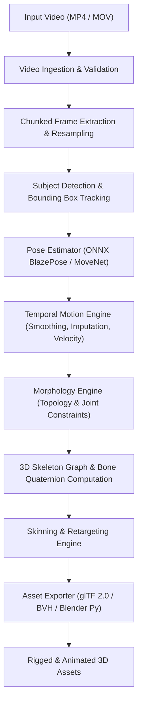

# Leocherd Iris Energy - Technical Architecture

## 1. System Overview

**Leocherd Iris Energy** is a Python-first, modular platform designed to ingest monocular video footage of moving subjects, estimate articulation keypoints across time, infer skeletal topology, reconstruct 3D joint transformations, and export rigged, animated assets (glTF, BVH, and Blender Python scripts).

---

## 2. Mathematical & Algorithmic Foundations

### 2.1 Monocular 3D Pose Lifting & Depth Invariance
Monocular RGB capture does not provide direct ground-truth physical metric depth. Given 2D screen projections $p_i = (u_i, v_i)$ and normalized depth estimates $z_i \in [-1, 1]$ or metric root-relative offsets:
1. **Root Centering:**
   $$\vec{P}_{local, i}(t) = \vec{P}_i(t) - \vec{P}_{root}(t)$$
   where $\vec{P}_{root}$ is typically the midpoint of the hips (for bipeds/humans) or center-of-mass pelvis.

2. **Kinematic Bone Length Preservation:**
   For any connected bone between parent $p$ and child $c$, biological bone length $L_{pc}$ is invariant over time:
   $$L_{pc} = \mathbb{E}_t \left[ \|\vec{P}_c(t) - \vec{P}_p(t)\| \right]$$
   During reconstruction, bone vectors $\vec{v}_{pc}(t) = \vec{P}_c(t) - \vec{P}_p(t)$ are regularized:
   $$\hat{\vec{v}}_{pc}(t) = L_{pc} \cdot \frac{\vec{v}_{pc}(t)}{\|\vec{v}_{pc}(t)\|}$$
   This enforces biological physical rigidity and prevents bone stretching or shrinking artifacts caused by monocular depth ambiguity.

### 2.2 Bone Orientation & Quaternion Formulation
For every bone $b$ connecting joint $A$ to joint $B$:
- **Rest Pose Direction Vector:** $\vec{u}_b^{rest}$ (by convention along local $+Y$ or $+Z$ axis in rest state).
- **Target Direction Vector at time $t$:** $\vec{u}_b(t) = \frac{\vec{P}_B(t) - \vec{P}_A(t)}{\|\vec{P}_B(t) - \vec{P}_A(t)\|}$.
- **Rotation Vector and Angle:**
  $$\vec{a} = \vec{u}_b^{rest} \times \vec{u}_b(t), \quad \theta = \arccos\left(\vec{u}_b^{rest} \cdot \vec{u}_b(t)\right)$$
- **Unit Quaternion $q = [w, x, y, z]$:**
  $$w = \sqrt{(1 + \vec{u}_b^{rest} \cdot \vec{u}_b(t)) \cdot 2} \cdot 0.5, \quad (x, y, z) = \frac{\vec{a}}{4w}$$
- **Local Hierarchical Decomposition:**
  The local rotation $q_{local, c}$ of bone $c$ relative to its parent $p$ with world rotation $q_{world, p}$ is given by:
  $$q_{local, c} = q_{world, p}^{-1} \otimes q_{world, c}$$

### 2.3 Temporal Smoothing & Outlier Rejection
Raw frame-by-frame neural estimates suffer from high-frequency jitter and occlusions. Iris Energy applies a dual-stage temporal filter:
1. **Confidence-Weighted Outlier Clamping:**
   If confidence $c_i(t) < \tau$ (e.g. 0.3), the joint position is imputed using forward kinematic velocity extrapolation or cubic spline interpolation:
   $$\hat{\vec{P}}_i(t) = \vec{P}_i(t-1) + \vec{v}_i(t-1) \cdot \Delta t$$
2. **Adaptive One Euro Filtering (or Savitzky-Golay):**
   Low speed movements receive heavy filtering to eliminate jitter; high-speed transients decrease filtering cutoff frequency to eliminate lag:
   $$f_c = f_{c,min} + \beta \cdot \|\dot{x}\|$$

---

## 3. Core Subsystems

| Module | Responsibility | Key Classes / Functions |
| :--- | :--- | :--- |
| `iris.core.pipeline` | Stage orchestration, execution graph, event dispatch | `Pipeline`, `PipelineStage`, `ExecutionContext` |
| `iris.video` | Ingestion, validation, codec check, streaming frame reader | `VideoMetadata`, `VideoValidator`, `FrameExtractor` |
| `iris.vision` | Bounding box detection, IoU tracking, ROI crop | `SubjectDetector`, `SortTracker`, `DetectionResult` |
| `iris.pose` | Monocular 2D/3D pose estimation adapters | `PoseEstimator`, `ONNXBlazePoseEstimator`, `PoseFrame` |
| `iris.motion` | Temporal analysis, velocity/acceleration, interpolation | `MotionTrajectory`, `TemporalSmoother`, `OneEuroFilter` |
| `iris.morphology` | Skeleton topology definitions (Human, Biped, Quadruped) | `MorphologyRegistry`, `HumanMorphology`, `QuadrupedMorphology` |
| `iris.rigging` | Graph skeleton, rest pose, bone transforms, constraints | `SkeletonGraph`, `JointNode`, `BoneEdge`, `RigBuilder` |
| `iris.export` | glTF 2.0 with skin/animations, BVH export, Blender scripts | `GltfExporter`, `BVHExporter`, `BlenderScriptGenerator` |
| `iris.api` | FastAPI REST endpoints, job queues, asset downloads | `app`, `/api/v1/jobs`, `/api/v1/rigs` |

---

## 4. Hardware Awareness & Execution Profiles

1. **`CPU_LIGHTWEIGHT` (Active on 2-Core / Sandy Bridge Pentium / No AVX):**
   - ONNX Runtime CPU Execution Provider.
   - Resamples video to 15 FPS and max dimension 720p.
   - Chunked batch size: 1-4 frames to maintain RAM utilization $< 1.5$ GB.
   - Implements native glTF 2.0 and BVH file generation without requiring Blender binary.

2. **`CUDA_GPU_HIGH_PRECISION` (Available when NVIDIA GPU present):**
   - CUDA Execution Provider.
   - Full 30/60 FPS frame evaluation.
   - Deep batch inference.
