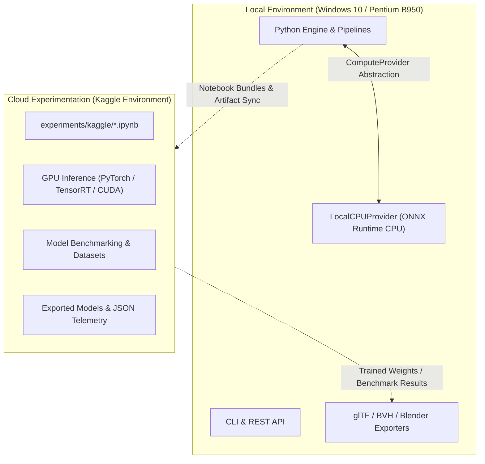

# Hybrid Compute Strategy: Local Workstation & Cloud Experiments

## 1. Context & Architectural Separation

Development on Leocherd Iris Energy operates across two hardware domains:

1. **Local Workstation:**
   - Dual-core CPU without AVX, 8 GB RAM, integrated graphics (no CUDA).
   - Responsible for code authoring, local unit testing, lightweight inference (`CPU_LIGHTWEIGHT` ONNX profile), video validation, asset serialization (glTF / BVH), REST API, and job orchestration.
   - Requires zero cloud connection to remain 100% operational.

2. **Remote Cloud (Kaggle Notebooks / GPU Compute):**
   - High-performance NVIDIA GPUs (Tesla T4, P100) and substantial vCPU/RAM.
   - Dedicated to compute-heavy experimentation: large model inference benchmarking, full-resolution 60 FPS temporal optical flow, multi-subject tracking, fine-tuning, and heavy model evaluations.
   - **Important Constraint:** Kaggle is an ephemeral experimentation platform, not a 24/7 web server. Notebooks run in sessions with strict timeouts and quota limits.



---

## 2. Compute Provider Abstraction

The platform defines a clean object-oriented abstraction in `iris.compute.base.ComputeProvider`:

```python
class ComputeProvider(ABC):
    @abstractmethod
    def detect_capabilities(self) -> ProviderCapabilities: ...

    @abstractmethod
    def submit_job(self, job_spec: JobSpecification) -> JobHandle: ...

    @abstractmethod
    def get_job_status(self, job_id: str) -> JobStatus: ...

    @abstractmethod
    def retrieve_result(self, job_id: str) -> JobResult: ...
```

Supported Providers:
- `LocalCPUProvider`: Runs inference locally using ONNX Runtime with bounded thread count and downsampled frame streaming.
- `LocalGPUProvider`: Automatically enabled when an NVIDIA CUDA device is detected locally.
- `KaggleExperimentProvider`: Packages video datasets and experiment configurations into Kaggle-ready notebook bundles and retrieves exported artifacts.

---

## 3. Privacy & Data Governance Rules
- Videos and datasets are **never** transmitted to remote cloud services without explicit, interactive user consent.
- Experiments running on Kaggle must utilize public benchmark datasets or user-approved anonymized clips.
- API keys, Kaggle credentials, and environment secrets are never committed to Git or embedded in notebooks.
