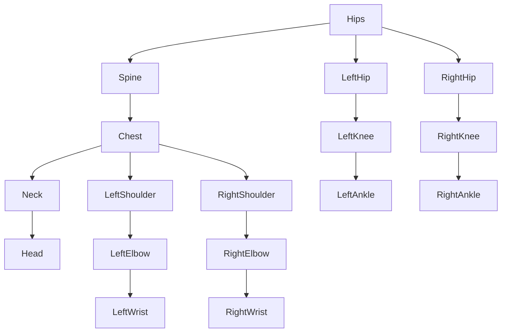

# Skeleton Reconstruction & Morphology Engine

## 1. Graph-Based Skeleton Representation

In `iris.rigging`, a skeleton is modeled as a directed rooted tree $G = (V, E)$:
- **Vertices $V$ (Joints):** Joint nodes carry anatomical name, 3D rest position $\vec{P}_{rest}$, degrees of freedom, and coordinate frames.
- **Edges $E$ (Bones):** Directed edge $(u, v)$ indicates joint $u$ is the anatomical parent of joint $v$.
- **Root Node:** A designated joint (e.g. `Hips` or `Pelvis`) with no parent, anchoring the global world position.

## 2. Morphology Plugins

The system decouples morphology topology from the pose detector. Supported morphologies:
1. **Human (`iris.morphology.human`):** 24-joint standard humanoid hierarchy matching standard bipedal gaming and VFX conventions (compatible with Mixamo / Blender Rigify).
2. **Biped (`iris.morphology.biped`):** Generalized biped supporting tail joints, custom digitigrade/plantigrade leg structures.
3. **Quadruped (`iris.morphology.quadruped`):** Spine chain with scapula, four independent limb kinematic chains, neck, head, and articulated tail.
4. **Serpentine (`iris.morphology.serpentine`):** Arbitrary $N$-segment continuous spine chain.
5. **Tentacular (`iris.morphology.tentacular`):** Multi-chain radial branching topology.
6. **Custom (`iris.morphology.custom`):** JSON / YAML definition of arbitrary joint graphs.

## 3. Mathematical Coordinate Conventions

Iris Energy adheres to the standard 3D graphics coordinate convention:
- **Right-Handed Coordinate System:**
  - $+X$: Subject's Anatomical Left (Screen Right when facing camera)
  - $+Y$: Upwards (Vertical elevation)
  - $+Z$: Forwards (Depth towards camera, or depth into scene depending on export target)
- **glTF 2.0 Target:** $+Y$ Up, $+Z$ Forward, $+X$ Right.
- **Blender Target:** $+Z$ Up, $+Y$ Forward, $+X$ Right (automatic coordinate frame transformation applied during export).
- **Rotations:** Unit quaternions $q = (x, y, z, w)$ normalized to $\|q\| = 1.0$.
