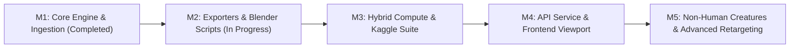

# Technical Roadmap: Leocherd Iris Energy

## Roadmap Phases & Milestones

---

### Milestone 1: Foundation & Local Pose Reconstruction (COMPLETED)
- [x] Host environment diagnostics and hardware profiling.
- [x] Memory-bounded streaming video ingestion and frame downsampling.
- [x] Real 3D pose estimation with ONNX BlazePose (`pose_estimation_mediapipe_2023mar.onnx`).
- [x] Kinematic bone-length invariance regularizer.
- [x] Adaptive temporal motion smoothing via One Euro Filter.
- [x] Multi-morphology graph architecture (Human, Biped, Quadruped, Serpentine, Tentacular, Custom).

### Milestone 2: 3D Asset Export & Blender Automation (CURRENT MILESTONE)
- [ ] Standalone glTF 2.0 generator with skeleton nodes, skinning inverse bind matrices, and quaternion animation tracks.
- [ ] Biovision Hierarchy (BVH) motion capture exporter with Euler rotational channels.
- [ ] Headless Blender automation scripts (`blender/create_armature.py`, `apply_animation.py`, `export_asset.py`).
- [ ] End-to-end integration test from synthetic video to exportable 3D asset.

### Milestone 3: Hybrid Compute Provider & Kaggle Notebooks
- [ ] `iris.compute` abstraction (`ComputeProvider`, `LocalCPUProvider`, `LocalGPUProvider`, `KaggleExperimentProvider`).
- [ ] Dedicated Kaggle experimentation suite (`experiments/kaggle/00_` through `07_`).
- [ ] Versioned model artifact export and experiment telemetry logs.

### Milestone 4: FastAPI REST Service & Interactive CLI
- [ ] FastAPI backend with job queue, video upload validation, progress polling, and asset downloads.
- [ ] Universal CLI entrypoint (`main.py`) with commands for inspection, batch reconstruction, and diagnostics.
- [ ] Unit and integration test coverage across all subsystems.

### Milestone 5: Non-Human Creatures & Production Hardening
- [ ] Quadruped model benchmark and multi-limb kinematic solver.
- [ ] Serpentine spinal curvature solver.
- [ ] Automatic rigging retargeting across mismatched morphological rest poses.
